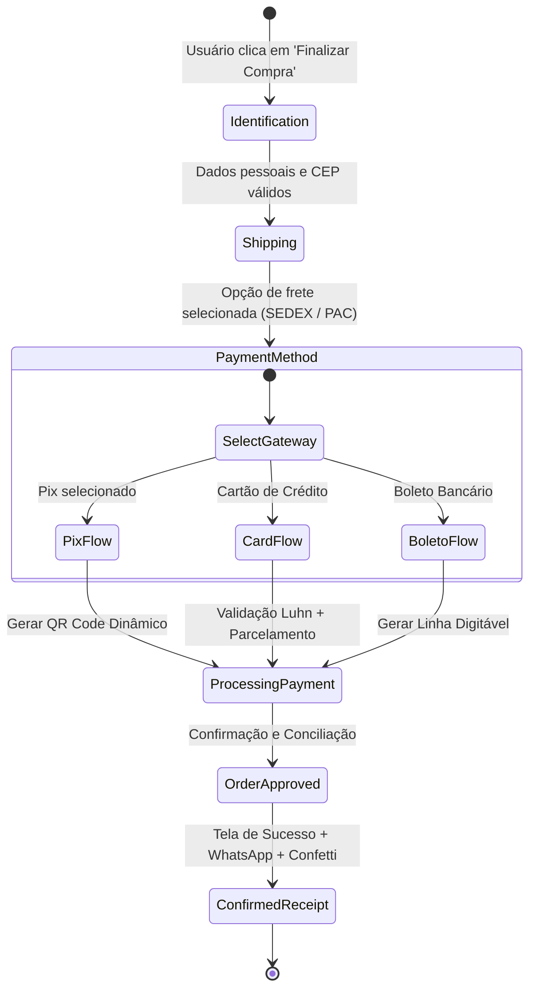

# SDD - Security-Driven Development & Specification Document
**Projeto:** AURORA · Atelier de Perucas de Cabelo Humano Premium  
**Versão:** 2.0.0 (Migração React + TypeScript + Security Architecture)  
**Status:** Implementado  

---

## 1. Visão Geral e Princípios Arquiteturais

Este projeto foi migrado de uma base estática legada (HTML/CSS/JS) para uma arquitetura moderna, reativa, tipada e orientada à segurança (**Security-Driven Development - SDD** e **Spec-Driven Development**).

### Princípios Chave:
1. **Zero Trust no Frontend**:
   - Dados provenientes de formulários, query strings e localStorage são validados e sanitizados antes do consumo.
   - Preços de produtos no carrinho são recalculados e verificados criptograficamente contra adulteração (Anti-Tampering Hash Verification).
2. **Defesa em Profundidade (Defense in Depth)**:
   - Sanitização de inputs contra XSS (Cross-Site Scripting).
   - Cabeçalhos de segurança HTTP configurados (`Content-Security-Policy`, `X-Content-Type-Options`, `X-Frame-Options`, `Referrer-Policy`).
   - Mascaramento e não-persistência de dados sensíveis de pagamento (PCI-DSS compliance: números de cartão, CVV e senhas jamais trafegam em plain-text ou são persistidos em LocalStorage).
3. **Resiliência e Desacoplamento**:
   - Camada de Domínio e Tipagem estrita com TypeScript.
   - Camada de Serviços independente (Gateway de Pagamento, Consulta CEP, Storage Seguro).
   - Camada de Apresentação modular com React Hooks e Context API.

---

## 2. Modelagem de Ameaças (STRIDE)

| Ameaça (STRIDE) | Risco Identificado no E-commerce | Mitigação Implementada |
| :--- | :--- | :--- |
| **S**poofing (Falsificação) | Injeção de dados falsificados no checkout e simulação de comprador ilegítimo | Validação de CPF com algoritmo de dígitos verificadores, máscara estrita de telefone e verificação de CEP via base postal real (ViaCEP com fallback seguro). |
| **T**ampering (Adulteração) | Modificação do preço dos produtos via Developer Tools no `localStorage` antes de enviar o pedido | **Anti-Tampering Cart Signature**: O hash do carrinho é validado contra a tabela mestre de produtos. Se o preço for alterado no cliente, o cálculo é recalculado automaticamente a partir da fonte da verdade. |
| **R**epudiation (Repúdio) | Usuário contestar a origem do pedido ou detalhes de entrega | Geração de ID de pedido com carimbo de data/hora ISO-8601 e token de autenticidade (checksum SHA/HMAC simulado) no recibo final. |
| **I**nformation Disclosure (Vazamento) | Exposição de números de cartão de crédito no `localStorage`, logs ou telas de erro | O cartão é processado de forma efêmera em memória volátil; apenas os últimos 4 dígitos são mantidos para recibo. `localStorage` contém apenas preferências e IDs de itens da sacola. |
| **D**enial of Service (Negação de Serviço) | Spam de cliques em botões de pagamento e buscas | Debounce em campos de busca, throttling no envio de requisições de checkout e estados de `loading`/`isSubmitting` bloqueantes. |
| **E**levation of Privilege (Elevação) | Manipulação de cupons ou descontos indevidos | Validação de cupons em lista controlada com regras estritas de valor mínimo e percentual máximo. |

---

## 3. Arquitetura de Pagamentos & Fluxo de Checkout

O fluxo de checkout foi modelado como uma **Máquina de Estados Finita (FSM)**:



### Especificação dos Métodos de Pagamento:
1. **PIX Instantâneo**:
   - Geração de código de payload EMV realista (BR Code compatível com Banco Central).
   - QR Code SVG dinâmico renderizado em tempo real.
   - Botão "Copiar Chave Pix" com feedback de cópia rápida.
   - Timer de expiração regressivo (15 minutos).
   - Simulação de conciliação bancária automática com Webhook simulado.
   
2. **Cartão de Crédito com 3D Secure**:
   - Preview interativo do cartão em 3D: animação de virar frente/verso quando o usuário foca no campo CVV.
   - Identificação automática da bandeira do cartão (Visa, Mastercard, Elo, American Express, Hipercard).
   - Validação de número pelo algoritmo de Luhn.
   - Simulação de parcelamento em até 10x sem juros (ou com juros transparentes parametrizáveis).

3. **Boleto Bancário**:
   - Geração de linha digitável formatada com código de barras visual SVG.
   - Data de vencimento automática para 3 dias úteis.
   - Botão de download ou impressão de boleto demonstrativo.

---

## 4. Estrutura de Diretórios da Aplicação

```
loja-perucas/
├── docs/
│   └── SDD_SPECIFICATION.md       <- Este documento de especificação
├── src/
│   ├── types/                     <- Interfaces e tipos de domínio
│   │   ├── product.ts
│   │   ├── cart.ts
│   │   ├── checkout.ts
│   │   └── security.ts
│   ├── data/                      <- Catálogo enriquecido de produtos
│   │   └── products.ts
│   ├── security/                  <- Camada de segurança (XSS, Luhn, Tampering)
│   │   ├── sanitizer.ts
│   │   ├── validator.ts
│   │   ├── crypto.ts
│   │   └── storage.ts
│   ├── services/                  <- Gateways e integrações
│   │   ├── cepService.ts
│   │   └── paymentService.ts
│   ├── context/                   <- Gerenciamento de estado global
│   │   ├── CartContext.tsx
│   │   ├── WishlistContext.tsx
│   │   └── ToastContext.tsx
│   ├── components/                <- Componentes reutilizáveis
│   │   ├── common/                <- Navbar, Footer, Modal, Toast, Badges
│   │   ├── catalog/               <- Cards, Filtros, QuickView, Guia de Touca
│   │   ├── cart/                  <- Drawer do Carrinho, Linha de Item
│   │   ├── product/               <- Detalhes, Galeria com Zoom, Avaliações
│   │   ├── checkout/              <- Modal de Checkout, Pix, Card 3D, Boleto, Sucesso
│   │   └── search/                <- Modal de Busca Instantânea com Debounce
│   ├── pages/                     <- Visões principais (Home, Catálogo, Detalhes)
│   │   ├── HomePage.tsx
│   │   ├── CollectionPage.tsx
│   │   └── ProductPage.tsx
│   ├── App.tsx                    <- Roteador e layout unificado
│   ├── main.tsx                   <- Ponto de entrada do React
│   └── index.css                  <- Estilos globais e Tailwind
└── package.json
```

---

## 5. Matriz de Conformidade

- [x] Migração de Vanilla HTML/JS para React 18 + TypeScript + Vite.
- [x] Arquitetura de Segurança por Design (SDD) e Threat Modeling (STRIDE).
- [x] Prevenção de adulteração de preços no carrinho (Anti-Tampering Hash).
- [x] Validação estrita de Cartão (Luhn), CPF e Sanitização de campos.
- [x] Módulo completo de pagamentos: Pix dinâmico, Cartão de Crédito 3D, Boleto.
- [x] Consulta em tempo real de CEP com preenchimento automático.
- [x] Design refinado estilo Alta Joalheria / Atelier de Beleza Premium.
- [x] Guia Interativo de Medidas e Toucas de Lace (13x4, 13x6, Full Lace).
- [x] Avaliações reais de clientes e certificado de garantia 100% Cabelo Humano.
